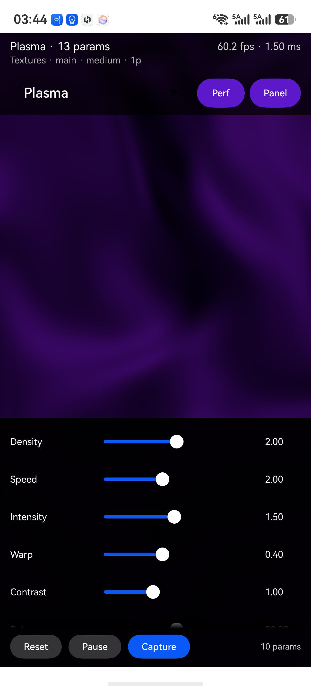
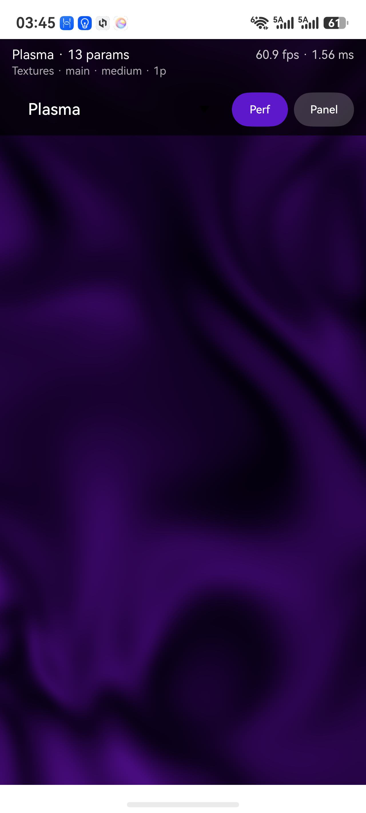
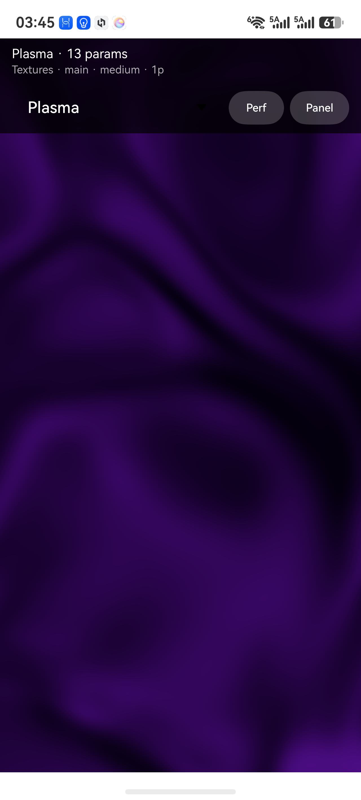

# shaderport 示例工程（entry）

> HarmonyOS 示例 App：演示如何把 [`@quizzyjoy/shaderport`](https://github.com/quizzyjoy/shaderport/tree/main/harmony/library)（HAR）里的
> 48 个 GLSL ES 3.00 效果，通过 **XComponent + EGL/GLES 3.0** 真正渲染出来。
> 真机实测：**Mate 80（VYG-AL30，HarmonyOS 7.0）**。

| 主界面（参数面板展开） | 隐藏参数面板 | 隐藏性能信息 |
|---|---|---|
|  |  |  |

## 它演示了什么

- 从 HAR 的 `rawfile` 读取 48 个效果的**规格 + GLSL**，交给 native 渲染
- **spec 驱动**的参数面板（range / color / select / position / boolean，零硬编码 UI）
- **多 pass RTT**：Blur / Glow / CursorRipples（ping-pong + premultiplied alpha）
- **指针**：touch / hover / mouse → `_sys.pointer`（CursorRipples 会跟随）
- **尺寸变化**：折叠/旋转触发 RTT 重建，不拉伸
- **性能**：FPS / CPU 提交时间、`1x / 0.75x / 0.5x` 渲染档位
- **确定性抓帧**：与参考图逐像素对比

## 架构

```
entry（本模块）                     library（HAR）
┌─────────────────────────┐        ┌──────────────────────────┐
│ Index.ets               │        │ Index.ets → 9 个 API      │
│  ├─ 工具栏/参数面板       │◀──────▶│  ├─ listEffects           │
│  └─ XComponent          │  ArkTS │  ├─ getEffect             │
│                         │        │  ├─ getPassSources        │
│ cpp/                    │        │  ├─ getDefaultParams      │
│  ├─ napi_init.cpp  ←桥   │        │  └─ getParamDescriptors   │
│  └─ renderer.cpp        │        │ rawfile/effects/<id>/     │
│     EGL / GLES3 / RTT   │        │   spec.json + *.glsl      │
└─────────────────────────┘        └──────────────────────────┘
        │ 渲染                          纯资产 + 纯逻辑
        ▼
     OpenGL ES 3.0
```

**数据流**：`getPassSources(id)` → `nativeSetEffect(fragments, blocks, instances)` → native 编译/链接 →
`getDefaultParams(id)` 逐条 `nativeSetParam(name, values)` → 每帧填 `_sys.*` 后绘制。

## 环境

| 组件 | 版本 |
|---|---|
| DevEco Studio | 26.0.0.821 |
| HarmonyOS SDK | API 26（platform 26.0.0） |
| compatibleSdkVersion | 5.0.0(12) |
| 设备类型 | phone + tablet（真机需支持 GLES 3.0） |

## 构建与运行

### 方式 A：DevEco Studio（推荐）

1. 用 DevEco 打开仓库里的 **`harmony/`**（不是仓库根）
2. `File > Project Structure > Signing Configs` → 勾选 **Automatically generate signature**（需登录华为账号）
3. 连接真机 → 选择 `entry` → **Run**

### 方式 B：命令行

```bash
cd harmony

# 构建（签名配置就绪时才产出已签名 HAP）
hvigorw assembleHap --mode module -p product=default -p module=entry@default

# 安装并启动
hdc install -r entry/build/default/outputs/default/entry-default-signed.hap
hdc shell aa force-stop com.quizzyjoy.shaderport.demo
hdc shell aa start -a EntryAbility -b com.quizzyjoy.shaderport.demo
```

> ⚠️ 未签名 HAP 只能装模拟器；真机必须在 DevEco 里配置自动签名。
> 签名块会写进 `harmony/build-profile.json5`，**不要提交**（见 [签名管理](https://github.com/quizzyjoy/shaderport/blob/main/docs/signing.md)）。

## Demo 使用教程

### 顶部信息行

```
Plasma · 13 params                    60.2 fps · 1.65 ms
Textures · main · medium · 1p
```

- 左：当前效果名 + 参数数量
- 右：FPS 与 CPU 提交时间（受 **Perf** 控制显隐）
- 第二行：分类 · 用途层 · 成本档 · pass 数

### 工具栏（始终可见）

| 控件 | 作用 |
|---|---|
| **效果下拉** | 48 个效果，选中即切换（同时重建 pass 与参数面板） |
| **Scale** | `1x → 0.75x → 0.5x → 1x`，整条链低分辨率渲染后线性上采样 |
| **Perf** | 显示/隐藏 FPS + CPU 时间（激活为紫色） |
| **Panel** | 显示/隐藏下方参数面板 |

### 参数面板

由 `spec.props[].ui` **自动生成**，不写死任何控件：

| `kind` | 控件 |
|---|---|
| `range` | Slider（带数值显示） |
| `color` | Hex 输入 |
| `select` | 下拉选择 |
| `position` | x / y 双 Slider |
| `boolean` | Switch |

底部：**Reset**（恢复默认）· **Pause/Play**（冻结时间）· **Capture**（抓帧）。

### 指针

在画布上触摸拖动（或鼠标悬停）会更新 `_sys.pointer`；
选 **CursorRipples** 可以看到涟漪跟随指针。

### 抓帧与像素对比

```bash
# 1) demo 里点 Capture（会写入沙箱 files/）
# 2) 拉取原始 RGBA
hdc file recv \
  /data/app/el2/100/base/com.quizzyjoy.shaderport.demo/haps/entry/files/capture-plasma.rgba \
  /tmp/capture-plasma.rgba

# 3) 与参考渲染器比较
node tools/render-reference/run.mjs --capture /tmp/capture-plasma.rgba --only plasma
```

阈值默认 `meanAbs ≤ 1`、`over8 ≤ 1%`、band ≤ 2；高频噪声效果在 `spec.validation.pixelDiff` 里单独放宽。

## native 侧结构（`src/main/cpp`）

| 文件 | 职责 |
|---|---|
| `renderer.cpp` / `.h` | EGL 上下文、GLES 3.0 管线、**UBO 反射**（`glGetActiveUniformsiv` 取偏移）、RTT ping-pong、Scale、指针、抓帧 |
| `napi_init.cpp` | ArkTS ↔ native 桥（`nativeInit` / `nativeSetEffect` / `nativeSetParam` / …） |
| `types/libentry/Index.d.ts` | 桥接口的 TS 声明 |

渲染契约（varying 名、UBO 块名、颜色/alpha 规则）见
[包的 README · 渲染契约](https://github.com/quizzyjoy/shaderport/blob/main/harmony/library/README.md#渲染契约native-侧必须做什么)。

## 性能（Mate 80 1280×2598）

| 效果 | FPS | cost |
|---|---|---|
| SolidColor / 轻渐变 | 120 | very-low |
| Plasma / PerlinNoise / Aurora | ~60 | medium |
| Blur / Glow（2 pass） | 56–58 | medium |
| FlowingGradient | 54 | medium |
| MeshGradient | **11.8** | **high** |

> 背景类（MeshGradient / FlowingGradient / Aurora）建议用 `Scale` 降到 0.5–0.75。

## 排障

| 现象 | 处理 |
|---|---|
| `EGL init failed` | XComponent 是否为 `SURFACE`；`nativeInit` 是否在 surface 就绪后调用 |
| 黑屏但状态正常 | 看 hilog `ShaderPort`：编译/链接/UBO 报错；确认 `nativeSetEffect` 收到 pass |
| 真机安装失败 `no signature file` | DevEco 里配置自动签名 |
| `hdc` 找不到设备 | `hdc list targets`；开启无线调试或换 USB 线 |
| 切换效果后参数面板为空 | `getParamDescriptors` 依赖 spec 的 `props`，确认 rawfile 已同步 |
| 画面被裁切/拉伸 | 确认 `onAreaChange` 的 resize 已传到 native；Scale 档位下不要改 viewport |

## 相关文档

- 📘 [使用教程（从零接入）](https://github.com/quizzyjoy/shaderport/blob/main/docs/usage-guide.md)
- 📦 [包 README（API / 渲染契约）](https://github.com/quizzyjoy/shaderport/blob/main/harmony/library/README.md)
- 🗂 [工程总览（harmony/README.md）](../README.md)
- 🧾 [效果规格格式](https://github.com/quizzyjoy/shaderport/blob/main/docs/spec-format.md)
- 📱 [设备矩阵](https://github.com/quizzyjoy/shaderport/blob/main/docs/device-matrix.md)
